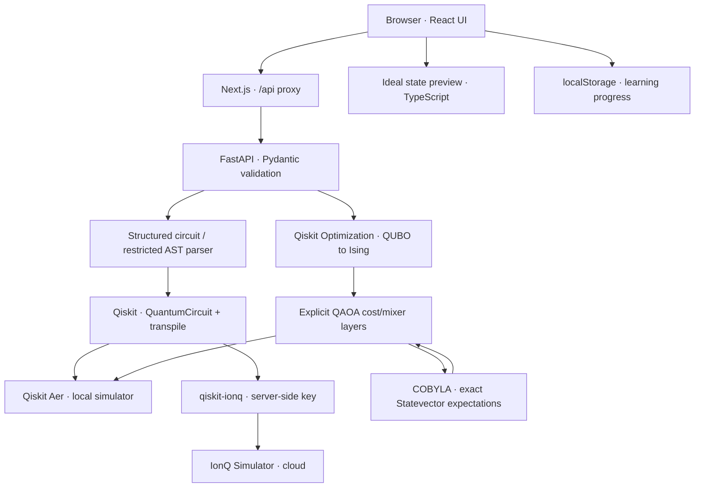
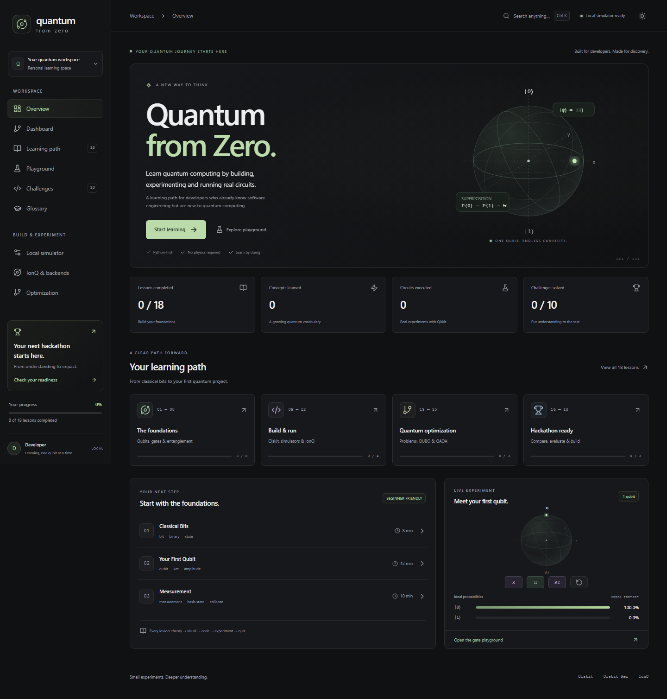
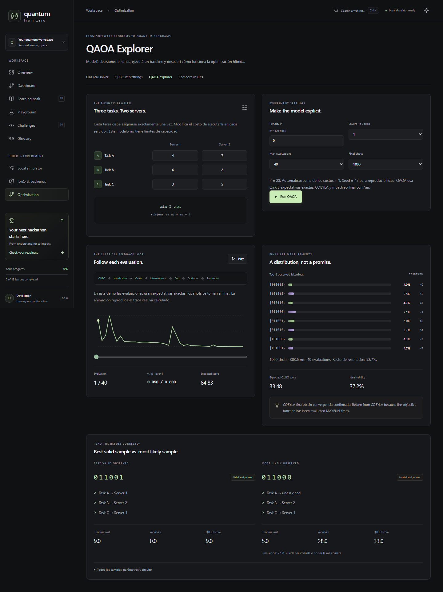
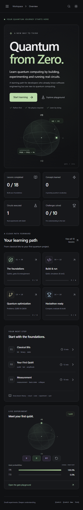

# Quantum from Zero

Creé este proyecto para prepararme para la hackathon de computación cuántica: aprender los fundamentos, experimentar con circuitos reales y practicar optimización con QUBO y QAOA.

Una plataforma educativa para developers backend: desde bits y amplitudes hasta circuitos reales, QUBO y QAOA. Interfaz oscura, visualizaciones interactivas, 18 lecciones en español, ejemplos Python, 10 challenges y progreso local. No requiere cuenta ni conocimientos de física.

## Quick start

Requisitos: Node.js 24 LTS, Python 3.12 y [uv](https://docs.astral.sh/uv/getting-started/installation/). También se puede usar Docker Compose 2.24 o posterior.

En Windows con PowerShell 7, desde la raíz:

```powershell
./scripts/dev.ps1 -Install
```

Abrí [la aplicación](http://localhost:3000) y [la documentación de la API](http://localhost:8000/docs). El script inicia ambos servicios, guarda logs en `.local/` y los detiene al presionar Ctrl+C. Si PowerShell bloquea scripts, usá las dos terminales de abajo.

Con Docker:

```sh
docker compose up --build
```

Con dos terminales:

```sh
# Terminal 1
cd backend
uv sync --locked
uv run uvicorn app.main:app --reload --host 127.0.0.1 --port 8000
```

```sh
# Terminal 2
cd frontend
npm ci
npm run dev
```

En Linux/macOS, `make install`, `make frontend` y `make backend` hacen lo mismo; `make dev` usa Compose. Las dependencias reproducibles están en `frontend/package-lock.json` y `backend/uv.lock`.

## What is this project?

Un recorrido donde cada lección conecta **concepto → intuición → visualización → código → experimento → ejercicio → quiz**. El objetivo es explicar los resultados, no memorizar llamadas de una librería.

El simulador del navegador ofrece una vista previa exacta e ideal. Los botones de ejecución llaman a FastAPI, que construye y ejecuta circuitos con Qiskit. Un backend desconectado genera un mensaje de error; no se fabrican resultados de ejecución.

## Architecture



```text
frontend/
  src/app/                 Next.js App Router + responsive styles
  src/components/         shell, lessons, labs, optimization, shared UI
  src/lib/                curriculum, quantum preview, progress, API types
  tests/                  Vitest + React Testing Library
  e2e/                    Playwright browser integration tests
backend/
  app/models.py           bounded, typed circuit and optimization inputs
  app/parser.py           restricted Qiskit-shaped DSL; no Python execution
  app/quantum.py          circuit construction, Aer and IonQ adapters
  app/optimization.py     assignment model, QUBO, Ising, QAOA
  app/main.py             FastAPI endpoints and safe error handling
  tests/                  pytest physics, parsing, validation and API tests
  examples/               reproducible local examples
scripts/                  Windows startup and verification
```

### Frontend

Next.js 16, React 19, TypeScript y Tailwind CSS 4. El shell usa navegación cliente, una sidebar responsive, búsqueda global (Ctrl/Cmd K), modo oscuro por defecto y un modo claro. SVG representa la esfera de Bloch, circuitos y curvas de optimización. Las animaciones respetan `prefers-reduced-motion`.

El progreso usa un store observable independiente de la interfaz. Una futura autenticación puede reemplazar la persistencia local por un repositorio remoto con el mismo modelo: lecciones completadas, quizzes, challenges, lección actual, checklist y ejecuciones. No hay autenticación ni sincronización entre dispositivos en esta versión.

### Backend

FastAPI con Pydantic, type hints y límites: 1–8 qubits, hasta 64 gates y 10 000 shots. El builder visual limita a 4 qubits y 32 gates. El runner limita el texto a 6000 caracteres y valida toda la estructura antes de construir `QuantumCircuit`. Las mediciones son terminales y cubren todos los qubits; si se omiten, se agregan automáticamente.

Este MVP está pensado para ejecución local. Antes de exponerlo públicamente, agregá autenticación, cuotas por usuario, control de concurrencia y jobs persistentes. Las solicitudes IonQ actuales esperan hasta 120 s; un sistema productivo necesita consulta asíncrona de jobs.

## Features and routes

| Route | What you can do |
| --- | --- |
| `/` | Landing, learning path, progreso y qubit interactivo |
| `/dashboard` | Continuar, revisar vocabulario, quizzes y ejecuciones |
| `/learn`, `/learn/1` … `/learn/18` | Conceptos, ejemplos, experimentos y quizzes con feedback |
| `/playground/gates` | Aplicar X/H/RX/RY/RZ; ver fase, amplitudes y probabilidades |
| `/playground/measurement` | Cambiar shots y comparar estado ideal con frecuencias |
| `/playground/cnot` | Tabla de verdad interactiva con control q0 y target q1 |
| `/playground/entanglement` | Preparar Bell paso a paso y muestrear con Aer |
| `/playground/circuit` | Arrastrar o agregar gates, elegir qubits, parámetros y mediciones |
| `/playground/parameters` | Slider RY, esfera de Bloch, fórmula y ejecución |
| `/playground/qiskit` | Editor de sintaxis Qiskit restringida y ejecución segura |
| `/simulators/local` | Flujo circuit → transpile → simulator → job → counts |
| `/ionq` | Backends locales/cloud/QPU y arquitectura de IonQ |
| `/playground/ionq` | Comparar Aer y IonQ Simulator con el mismo circuito |
| `/optimization` | Costos editables, 64 combinaciones y óptimo clásico |
| `/optimization/qubo` | Matriz Q seleccionable y decoder de 6 bits |
| `/optimization/qaoa` | Capas reales, trace, playback y muestras finales |
| `/optimization/compare` | Calidad, tiempo y recursos de ambos métodos |
| `/challenges` | 4 ejercicios de código y 6 de razonamiento |
| `/glossary` | 34 términos con búsqueda y explicación simple/técnica |
| `/readiness` | Checklist persistente e ideas de Quantum Impact/Unlocked |

## Learning path

1. Classical Bits
2. Your First Qubit
3. Measurement
4. Hadamard & Superposition (incluye interferencia)
5. Shots & Probabilities
6. Multiple Qubits
7. CNOT
8. Bell States & Entanglement
9. Parameterized Circuits
10. Local Quantum Simulation
11. Qiskit Deep Dive (incluye qué es un backend)
12. IonQ Simulator
13. Optimization Problems
14. QUBO
15. QAOA
16. Classical vs Quantum
17. Quantum Advantage
18. Build Your First Quantum Project

Las lecciones están disponibles desde el inicio. Un quiz aprobado habilita marcar la lección como completada; podés repetirla y explorar sus laboratorios en cualquier momento. El denominador siempre es 18, reflejando el contenido implementado.

## How Qiskit works

```python
from qiskit import QuantumCircuit, transpile
from qiskit_aer import AerSimulator

qc = QuantumCircuit(2)
qc.h(0)
qc.cx(0, 1)
qc.measure_all()
backend = AerSimulator()
compiled = transpile(qc, backend, optimization_level=1)
counts = backend.run(compiled, shots=1000).result().get_counts()
```

`QuantumCircuit` representa instrucciones. H crea superposición y CX correlaciona amplitudes. `transpile` adapta las puertas al backend. `run` crea un job y `get_counts` devuelve las frecuencias observadas. Aer corre sobre una computadora clásica.

Las probabilidades ideales se calculan con `Statevector.from_instruction` **antes de medir**; son diferentes de `counts / shots`. El modelo es ideal, sin ruido. La esfera de Bloch representa un único qubit en un estado puro. El estado completo de Bell no puede representarse como dos vectores Bloch puros independientes.

### Bit order: an essential detail

Qiskit muestra `q[n-1]…q0`: **q0 es el bit derecho**. H(0) sobre dos qubits produce `(00 + 01)/√2`; CX(0,1) después produce `(00 + 11)/√2`. El modelo de asignación mapea:

```text
qubit:       q5     q4     q3     q2     q1     q0
variable:    x_C_2  x_C_1  x_B_2  x_B_1  x_A_2  x_A_1
bitstring:   0      1      1      0      0      1
assignment:  C→S1         B→S2         A→S1
```

### Safe code runner

Admite exclusivamente imports `QuantumCircuit` desde qiskit y `pi` desde math, una declaración `qc = QuantumCircuit(n, n)`, gates `h/x/cx/rx/ry/rz` y mediciones. Los ángulos admiten literales numéricos, `pi`, signos, multiplicación y división. `measure([0,1],[0,1])` conserva el mapping qi→ci. No admite loops, nombres de variables adicionales, funciones, archivos o otros imports.

`ast.parse` inspecciona el texto; nunca se llama a `eval`, `exec` o `subprocess` para ejecutar entradas. Los ejemplos de lecciones con `Parameter`, Aer o Qiskit Optimization son Python para tu entorno local y exceden deliberadamente este DSL.

## How IonQ works

Consultada la [documentación oficial de IonQ](https://docs.ionq.com/sdks/qiskit/index): el provider 1.x soporta Qiskit 2.x. El adaptador usa `IonQProvider(token=...)`, `get_backend("ionq_simulator")`, transpilation con `optimization_level=1`, mediciones explícitas y un resultado con timeout.

Copiá `backend/.env.example` a `backend/.env` y agregá:

```dotenv
IONQ_API_KEY=your_private_key
```

Reiniciá el backend. En `/playground/ionq`, elegí Hadamard, Bell o RY(π/3), ejecutá Aer y luego IonQ. El token permanece en FastAPI y no aparece en endpoints ni bundles frontend. Sin key, el endpoint responde 503 con **IonQ integration not configured**. Errores del provider no exponen credenciales.

Esta versión integra el simulador cloud. No envía jobs a QPUs. La API key puede requerir acceso/plan de IonQ; los resultados remotos solo se validan con credenciales reales. `seed` controla Aer, no garantiza reproducibilidad en IonQ.

## QUBO: from constraints to costs

Tres tareas, dos servidores, seis variables binarias y exactamente una asignación por tarea:

```text
F(x) = Σ c_ts x_ts + P Σ (x_t1 + x_t2 - 1)²
     = xᵀQx + 3P
Q_ii = c_i - P
Q_(2t,2t+1) = 2P
```

Q es triangular superior: no duplicamos acoplamientos en la parte inferior. Como x²=x, las penalidades aportan términos lineales y cuadráticos. La constante preserva el valor del objetivo. El P automático es suma de costos + 1; alcanza para mantener al óptimo válido en este modelo de costos no negativos. Un P manual pequeño puede favorecer bitstrings inválidos; eso forma parte del experimento educativo.

Brute force enumera 64 bitstrings; 8 cumplen las restricciones. El óptimo predeterminado es **011001, costo 9**: A→S1, B→S2, C→S1. `QuadraticProgram.to_ising()` transforma el objetivo en un `SparsePauliOp` y un offset. Los tests comparan las energías de los 64 estados contra el QUBO y el objetivo de negocio.

## QAOA: the real hybrid loop

El laboratorio construye explícitamente H inicial, fases de costo RZ/RZZ a partir del Hamiltoniano y mixer RX. `reps`/p controla el número de capas. SciPy COBYLA optimiza γ y β; cada evaluación usa **la expectativa exacta de Statevector** para hacer el experimento estable y transparente. Al final se ejecuta el circuito parametrizado con **Aer y shots reales**.

Se devuelve el trace real de evaluaciones, todos los parámetros, expected QUBO score, probabilidad ideal de factibilidad, samples, bitstring más frecuente y mejor muestra válida. La animación reproduce el trace ya calculado. Las barras muestran las ocho muestras más frecuentes y reportan el porcentaje restante; todos los resultados están disponibles en el panel expandible.

El algoritmo es aproximado. Puede agotar el presupuesto sin converger y puede muestrear soluciones inválidas. La mejor muestra, la más probable y el costo esperado son métricas distintas. Más capas o shots no garantizan una mejora. Para este ejemplo minúsculo los solvers clásicos suelen ser más rápidos y exactos. **Esta demo no demuestra quantum advantage.**

## Environment variables

| Variable | Location | Default / purpose |
| --- | --- | --- |
| `IONQ_API_KEY` | `backend/.env` | Opcional; habilita IonQ Simulator |
| `CORS_ORIGINS` | `backend/.env` | localhost/127.0.0.1:3000 |
| `API_URL` | `frontend/.env` or `.env.local` | http://127.0.0.1:8000; proxy servidor |
| `PYTHONUTF8` | shell | Usar `1` en Windows para imprimir diagramas |

Ninguna credencial usa el prefijo `NEXT_PUBLIC_`. En Docker, el proxy se construye con `http://backend:8000`; para otro destino, ajustá el build argument y reconstruí.

## Backend API

Ver contratos completos y probar requests en [Swagger](http://localhost:8000/docs).

| Method | Endpoint | Input |
| --- | --- | --- |
| GET | `/api/health` | Estado, versiones y bool IonQ configurado |
| POST | `/api/quantum/hadamard`, `/api/quantum/bell` | shots, optional seed |
| POST | `/api/quantum/circuit` | qubits, gates, shots, optional seed |
| POST | `/api/quantum/parameterized` | theta en radianes, shots |
| POST | `/api/quantum/code` | code del DSL, shots |
| POST | `/api/quantum/ionq` | mismo modelo que circuit; solo simulador |
| POST | `/api/optimization/classical` | costs[3][2], penalty opcional |
| POST | `/api/optimization/qubo` | costs, penalty, bitstring opcional |
| POST | `/api/optimization/qaoa` | costs, penalty, reps, iterations, shots, seed |

Ejemplo de circuito estructurado:

```json
{"qubits":2,"gates":[{"type":"H","target":0},{"type":"CX","control":0,"target":1}],"shots":1000,"seed":42}
```

Respuesta local: `counts`, `probabilities` observadas, `exact_probabilities`, `statevector` complejo antes de medir, circuito, shots, execution_ms y bit_order. Requests inválidos reciben 422; IonQ sin configuración 503; fallas del provider 502 sin información sensible.

## Tests and verification

```sh
make test
make lint
make build
make examples
```

En Windows: `./scripts/check.ps1` ejecuta tests, lint, build y ejemplos. Detené el servidor Next de desarrollo antes de construir para evitar compartir el directorio `.next`. Para tests de navegador, iniciá ambos servicios:

```sh
cd frontend
npx playwright install chromium
npm run test:e2e
```

Frontend: Vitest + Testing Library verifican normalización, fase/interferencia, Bell, orden de bits, builder, lecciones, glossary y persistencia. Backend: pytest verifica distribución H, Bell, rotaciones, CNOT, inputs inválidos, parser restringido, credenciales, QUBO/Ising en los 64 estados, baseline y QAOA. Playwright prueba el recorrido completo en navegador, ejecución vía API, quizzes, challenges, QAOA, modo claro y viewport mobile.

Ejemplos locales:

```sh
cd backend
uv run python -m examples.run_examples
# Solo si configuraste key y querés enviar un job remoto:
uv run python -m examples.run_examples --ionq
```

El [reporte de entrega](docs/DELIVERY.md) documenta versiones, resultados de verificación y límites de esta implementación.

## Screenshots

Las capturas verificadas se guardan en `docs/screenshots/`. Overview muestra la interfaz inicial; la segunda muestra una ejecución QAOA; la tercera, la vista mobile.







## What to learn next

1. Repetí H → RZ(π) → H y explicá interferencia usando amplitudes.
2. Prepará Bell, medí en otras bases y diferenciá entrelazamiento de correlación clásica.
3. Agregá restricciones de capacidad al scheduling y validá el QUBO con un baseline clásico.
4. Explorá noise models de Aer, sampling de expectativas y primitivas V2.
5. Investigá benchmarks, criterios de convergencia y selección de p; no extrapoles estos resultados pequeños.

## Quantum Impact / Quantum Unlocked

**Quantum Impact:** extender asignación a recursos cloud con capacidad y SLAs, scheduling, routing, attack paths, portfolio optimization o feature selection. Elegí una sola hipótesis y compará con MILP/heurísticas; justificá si el enfoque cuántico aporta algo medible.

**Quantum Unlocked:** convertir los laboratorios en un visualizador compartible de circuitos, entrelazamiento o QAOA, con animación de amplitudes y experimentos guiados. Una extensión posterior puede abordar networking. Las ideas se presentan como siguientes pasos; no están implementadas como productos independientes.

## Sources and compatibility

Consultadas antes de implementar y verificadas con las versiones instaladas; detalles en el reporte:

- [Qiskit Statevector](https://quantum.cloud.ibm.com/docs/en/api/qiskit/qiskit.quantum_info.Statevector)
- [Qiskit Aer simulation tutorial](https://qiskit.github.io/qiskit-aer/tutorials/1_aersimulator.html)
- [IonQ Qiskit integration](https://docs.ionq.com/sdks/qiskit/index)
- [Qiskit Optimization converters](https://qiskit-community.github.io/qiskit-optimization/tutorials/02_converters_for_quadratic_programs.html)
- [Qiskit qaoa_ansatz](https://quantum.cloud.ibm.com/docs/api/qiskit/2.3/qiskit.circuit.library.qaoa_ansatz)

No usamos `qiskit.execute`, `qiskit.Aer` ni imports históricos de `qiskit.providers.aer`. Cambios de dependencias deben validarse con los tests y ejemplos antes de actualizar locks.
