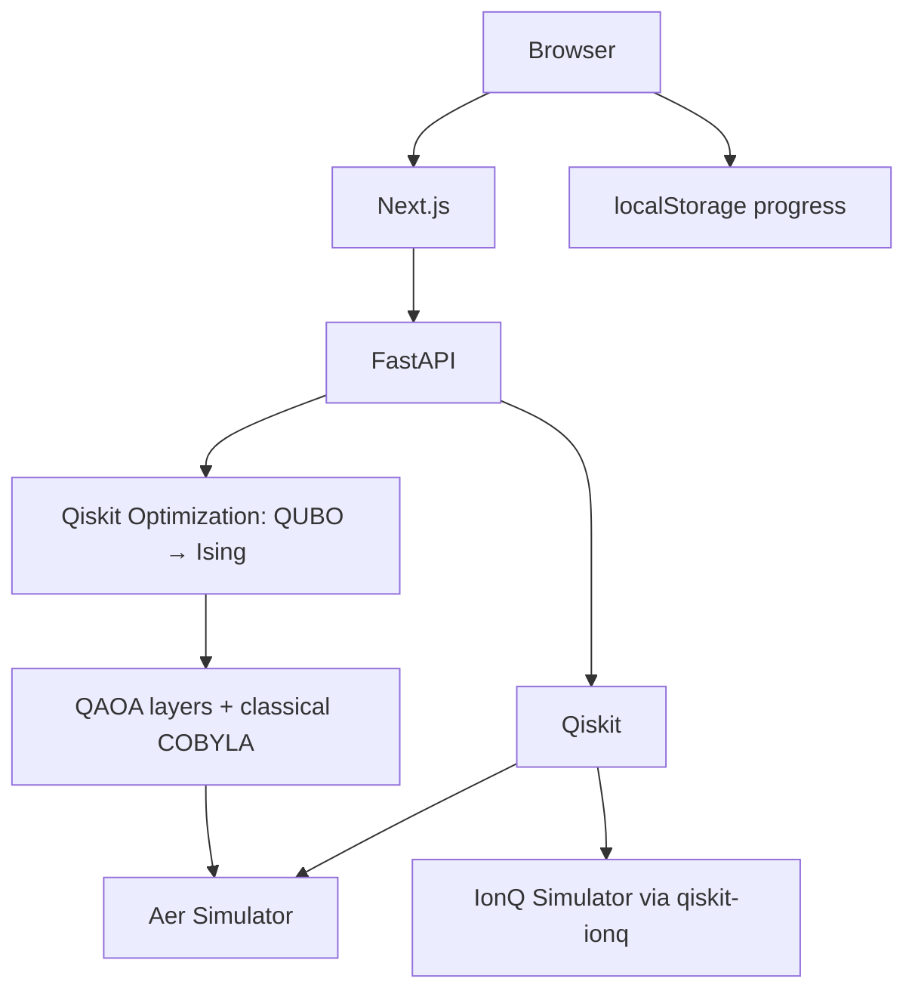

# Quantum from Zero — reporte de entrega

30 de septiembre de 2026. Aplicación completa de aprendizaje local, implementada en este workspace. La versión de producción se sirve en **http://localhost:3000**, con FastAPI en **http://localhost:8000**. Ambos servicios usan Docker Compose; no se publicó un sitio externo.

## Architecture

Next.js App Router + React + TypeScript + Tailwind CSS; FastAPI + Pydantic; Qiskit + Aer + qiskit-ionq + Qiskit Optimization. El navegador calcula vistas previas ideales y guarda progreso en localStorage. Las ejecuciones pasan por el proxy Next.js hacia FastAPI. La conversión de inputs a circuitos es estructurada y validada; no ejecutamos Python arbitrario.



Separación de dominio, circuitos, parsing, optimización, API, currículo y persistencia. La interfaz tiene búsqueda global, navegación responsive, modo oscuro y claro, SVG de circuitos y estados, microinteracciones y soporte de reducción de movimiento.

## Features implemented

- Landing y dashboard con métricas reales de progreso.
- 18 lecciones completas: concepto, intuición, explicación técnica, visual, código con tooltips, demo, experimento, ejercicio, quiz con feedback, takeaways y siguiente paso.
- Ocho laboratorios: gates, measurement, CNOT, Bell, circuit builder, parameters, Qiskit runner e IonQ.
- Constructor de circuitos con drag/drop, selección de target/control/ángulo, gates removibles y ejecución.
- Resultados de Aer: counts, frecuencias, probabilidades exactas, amplitudes complejas, circuito y tiempo.
- Optimización clásica, QUBO seleccionable, decoder de bitstrings, QAOA real con trace reproducible y comparación.
- Diez challenges: cuatro de código y seis de razonamiento, con validación y progreso.
- Glosario buscable de 34 términos, explicaciones simple/técnica y checklist de readiness.
- README, diagrama de arquitectura, ejemplos, variables de entorno, Makefile, scripts Windows, Dockerfiles y Compose.
- Capturas verificadas: [overview](screenshots/overview.png), [QAOA](screenshots/qaoa.png), [mobile](screenshots/mobile.png).

El editor es un textarea con templates y ejecución mediante DSL seguro. Los bloques de lectura tienen syntax highlighting y tooltips. No se agregó Monaco, autenticación ni sincronización entre dispositivos.

## Learning path

| Chapter | Lessons |
| --- | --- |
| The foundations | 01 Classical Bits; 02 Your First Qubit; 03 Measurement; 04 Hadamard & Superposition; 05 Shots & Probabilities; 06 Multiple Qubits; 07 CNOT; 08 Bell States & Entanglement |
| Build & run | 09 Parameterized Circuits; 10 Local Quantum Simulation; 11 Qiskit Deep Dive; 12 IonQ Simulator |
| Quantum optimization | 13 Optimization Problems; 14 QUBO; 15 QAOA |
| Hackathon ready | 16 Classical vs Quantum; 17 Quantum Advantage; 18 Build Your First Quantum Project |

El denominador del progreso es 18. Todas las lecciones son accesibles; aprobar el quiz habilita registrar su finalización. Se guardan también la lección actual, challenges, quizzes, ejecuciones y autoevaluación.

## Quantum concepts covered

Bits, qubits, kets, estados de base, amplitudes complejas, normalización, regla de Born, fase relativa, superposición, medición, shots, counts, interferencia, H/X/CX/RX/RY/RZ, circuitos, entrelazamiento y Bell. También SDKs, backends locales/cloud/QPU, transpilation, simulación clásica, ruido y decoherencia, parámetros, variables binarias, restricciones, penalidades, QUBO, Hamiltonianos, QAOA, VQE y comparación de recursos.

La plataforma explica explícitamente que 2ⁿ estados de base no equivalen a leer 2ⁿ respuestas, que una correlación en una sola base no prueba entrelazamiento, que IonQ Simulator no es una QPU y que un algoritmo cuántico no demuestra ventaja cuántica por sí mismo.

## Qiskit integration

Versiones verificadas en el entorno instalado y fijadas por lockfiles:

| Package | Version |
| --- | --- |
| Qiskit | 2.5.2 |
| Qiskit Aer | 0.17.2 |
| qiskit-ionq | 1.1.1 |
| Qiskit Optimization | 0.7.0 |
| FastAPI | 0.142.2 |
| Next.js | 16.3.8 |
| React / React DOM | 19.3.0 |
| TypeScript | 5.9.3 |
| Tailwind CSS | 4.3.3 |
| Vitest | 5.0.3 |

La ejecución usa `QuantumCircuit`, `transpile`, `AerSimulator.run` y `result().get_counts()`. `Statevector.from_instruction` produce probabilidades ideales antes de medir. No se usan APIs históricas de `execute` o `qiskit.Aer`.

Antes de implementar se consultaron [Qiskit Statevector](https://quantum.cloud.ibm.com/docs/en/api/qiskit/qiskit.quantum_info.Statevector), [Aer](https://qiskit.github.io/qiskit-aer/tutorials/1_aersimulator.html), [IonQ](https://docs.ionq.com/sdks/qiskit/index) y [Optimization](https://qiskit-community.github.io/qiskit-optimization/tutorials/02_converters_for_quadratic_programs.html). También se revisaron las guías incluidas en el Next.js instalado.

El runner web interpreta únicamente una sintaxis permitida y vuelve a validar sus gates con Pydantic. Imports arbitrarios, loops, funciones, archivos, `eval`, `exec` y llamadas ajenas a qc son rechazados. Medición terminal completa, mapping qi→ci y límites de recursos se aplican antes de ejecutar.

## IonQ integration

El adaptador real usa `IonQProvider`, `ionq_simulator`, transpilation con optimization_level=1, medición explícita y timeout. La API key solo vive en FastAPI. El proxy y el cliente admiten una espera de 150 s para un job de hasta 120 s.

**Estado de verificación:** no existe `IONQ_API_KEY` configurada en esta sesión; no se envió un job remoto. Sí se verificaron compatibilidad del provider instalado, endpoint sin configuración (503), templates de circuitos y protección de credenciales en errores (502). La UI permite comparar Aer con IonQ cuando se configure una key válida. No se ejecutan QPUs.

Para habilitarlo, copiar `backend/.env.example` a `backend/.env`, definir `IONQ_API_KEY` y recrear el servicio backend (`docker compose up -d --force-recreate backend`). El frontend nunca recibe la key.

## Local simulator

Ejemplos verificados con Qiskit/Aer tanto en Windows como dentro del contenedor Linux:

- Hadamard, 1000 shots, seed 42: **0 → 514, 1 → 486**.
- Bell, 1000 shots, seed 42: **00 → 510, 11 → 490**; sin resultados 01/10.
- RY en 0, π/2, π y 2π coincide con las probabilidades analíticas.
- H → RZ(π) → H produce |1⟩ por interferencia.
- CNOT coincide con las cuatro entradas de base usando bitstrings q1q0.

Los resultados muestreados pueden variar entre ejecuciones sin seed. Seeds permiten reproducir muestreo dentro de un entorno; optimización numérica y compilación pueden variar entre plataformas.

## QUBO

Tres tareas, dos servidores, seis variables: x_A_1, x_A_2, x_B_1, x_B_2, x_C_1, x_C_2, mapeadas a q0…q5. Restricción por tarea: exactamente una asignación. No se modela capacidad de servidores en este ejemplo inicial.

F(x) = Σ c_ts x_ts + PΣ(x_t1+x_t2−1)² = xᵀQx+3P. Matriz triangular superior; diagonal c−P y acoplamiento 2P. P automático = suma de costos + 1. Con costos predeterminados: **P=28, constante=84**.

El solver enumera 64 bitstrings y encuentra 8 válidos. Óptimo: **011001, costo 9**, A→S1, B→S2, C→S1. Los tests verifican objetivo, matriz Q y diagonal del Hamiltoniano Ising para **los 64 estados**, incluida la constante.

## QAOA

Implementación efectiva de capas H inicial, RZ/RZZ de costo y RX de mixer; conversión del Hamiltoniano por Qiskit Optimization. COBYLA ajusta γ/β para p/reps entre 1 y 3. El trace registra evaluaciones reales y puede reproducirse visualmente.

La optimización usa **expectativas exactas de Statevector**; la medición final usa **shots de Aer**. Esto es una elección educativa explícita. No se simula un ciclo con números inventados ni se presenta como ejecución sobre hardware cuántico.

En el ejemplo predeterminado con 40 evaluaciones y 1000 shots se observó una muestra válida de costo 9. La UI muestra aparte el bitstring más probable, mejor muestra válida, costo esperado, factibilidad ideal, parámetros y estado de convergencia. Encontrar una buena muestra no significa concentrar toda la distribución en el óptimo.

La comparación usa el mismo modelo y reporta calidad, tiempo total y evaluaciones. Para este problema pequeño brute force suele ser más rápido y exacto. No se afirma quantum advantage.

## Tests

| Check | Result |
| --- | --- |
| Backend pytest | 58 passed |
| Frontend Vitest / Testing Library | 19 passed |
| Playwright browser tests | 12 passed, en desarrollo y producción Docker |
| ESLint | Passed, sin warnings del proyecto |
| Ruff + format | Passed |
| Next production build (Windows) | Passed |
| Docker build frontend + backend (Linux) | Passed |
| Docker Compose startup and health | Passed |
| Hadamard / Bell / classical / QUBO / QAOA examples | Passed en Windows y Docker |
| npm dependency audit | 0 known vulnerabilities al verificar |
| IonQ remote simulator | No ejecutado: key ausente |

Las pruebas de navegador verifican progresos persistentes, efectos de puertas, runner restringido, Bell, constructor, QUBO, QAOA, challenges, navigation, modo claro y viewport 390 px. Se verifica además la ausencia de errores de JavaScript/hidratación. Todas las rutas de las 18 lecciones fueron inspeccionadas en navegador y se guardaron capturas.

El entorno pytest emite una advertencia de deprecación de su integración Starlette/httpx; los tests completan sin fallas. Las pruebas cuánticas validan probabilidades, fases, normalización y consistencia del modelo; no exigen que todo muestreo sea exactamente 50/50.

## How to run

Ya está funcionando en [localhost:3000](http://localhost:3000). API docs: [localhost:8000/docs](http://localhost:8000/docs).

Desde la raíz:

```sh
docker compose up --build
# O, segundo plano:
docker compose up -d --build
# Para detener:
docker compose down
```

Desarrollo Windows: `./scripts/dev.ps1 -Install` inicia ambos servicios si sus puertos están disponibles. También se puede ejecutar `npm run dev` en frontend y `uv run uvicorn app.main:app --reload` en backend, según el README.

`make frontend`, `make backend`, `make test`, `make lint`, `make build` y `make examples` están disponibles en entornos con Make. `./scripts/check.ps1` ofrece checks equivalentes en Windows. Ver [README](../README.md) para requisitos, ambiente, API y troubleshooting.

## What I should learn next

1. Recombinar amplitudes con H/RZ/H y explicar fase relativa.
2. Preparar Bell y medir en bases distintas para contrastar con correlaciones clásicas.
3. Ejecutar Qiskit local y luego IonQ Simulator con credenciales válidas.
4. Derivar penalidades y verificar todos los bitstrings de un QUBO pequeño.
5. Agregar capacidad y SLAs al problema de tareas, con un baseline MILP/heurístico.
6. Explorar ruido, expectativas estimadas con shots, primitivas V2 y costos de ejecución en hardware.

## How this could become a Quantum Impact project

Extender el modelo a scheduling y optimización de recursos cloud con capacidades, SLA, costos de migración y restricciones de negocio. Elegir una hipótesis medible: calidad bajo presupuesto de tiempo, factibilidad o robustez. Comparar con solvers clásicos competitivos sobre instancias crecientes antes de justificar el enfoque cuántico. Routing, attack paths, portfolios y feature selection son direcciones alternativas, no productos implementados.

## How this could become a Quantum Unlocked project

Convertir la plataforma en un visualizador de circuitos compartibles con animación de amplitudes y fases, explicación de entrelazamiento y traces de optimización. Agregar URLs de experimentos reproducibles, sesiones guiadas y ejemplos de networking. El valor inicial es hacer accesibles conceptos cuánticos con experimentos verificables y feedback útil.
